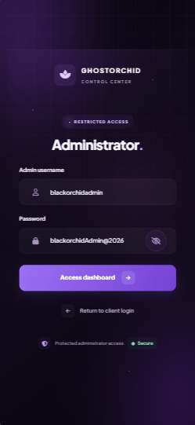
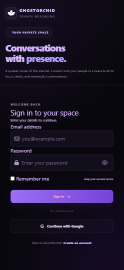
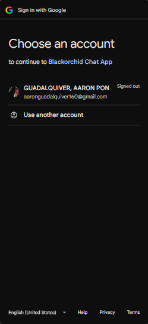
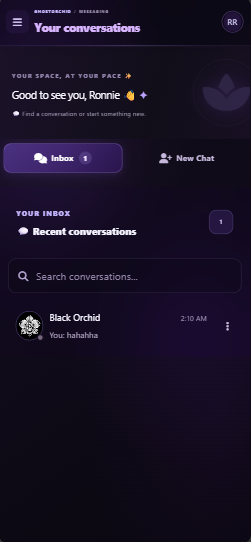
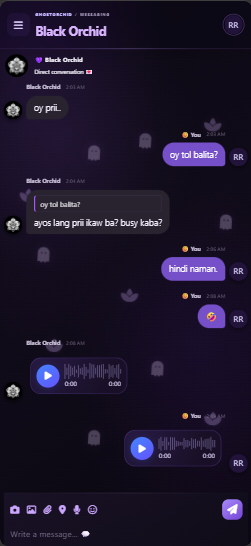
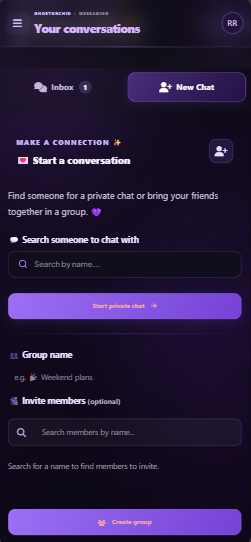
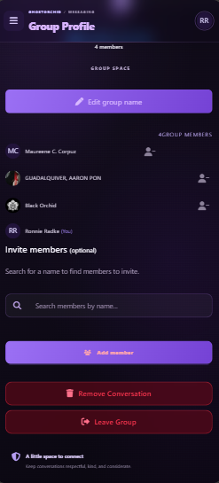
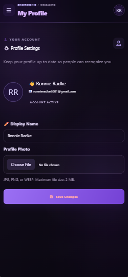

# GhostOrchid Chat App

A modern, responsive, real-time messaging platform built with Laravel, PHP, MySQL, Laravel Reverb, Laravel Echo, Pusher JS, and Google OAuth 2.0.

**GhostOrchid Chat** is a web-based communication application designed to provide a seamless messaging experience through a modern interface, user authentication, private conversations, and group chats.

---

## Table of Contents

- [About the Project](#about-the-project)
- [Features](#features)
- [Application Screenshots](#application-screenshots)
- [Technology Stack](#technology-stack)
- [System Requirements](#system-requirements)
- [Installation and Setup](#installation-and-setup)
- [Google OAuth 2.0 Setup](#google-oauth-20-setup)
- [Real-Time Messaging Configuration](#real-time-messaging-configuration)
- [Running the Application](#running-the-application)
- [Usage](#usage)
- [Security](#security)
- [License](#license)
- [Author](#author)

---

## About the Project

GhostOrchid Chat is a Laravel-based messaging application focused on real-time communication, user accessibility, and a clean, responsive user experience.

The application combines Laravel's backend capabilities with MySQL database management, Laravel Reverb for WebSocket communication, Laravel Echo and Pusher JS for browser-side messaging connections, and Google OAuth 2.0 for third-party authentication.

Its modern dark-themed interface provides users with an organized environment for managing conversations, communicating privately, creating groups, and maintaining their profiles.

## Features

### Authentication and User Management

- User registration and login
- Google Sign-In using OAuth 2.0
- Laravel Socialite integration
- User profile management
- Profile pictures and avatar display
- Administrative login and account management

### Messaging and Communication

- Private one-to-one conversations
- Group chat functionality
- Real-time messaging using Laravel Reverb
- WebSocket communication using Laravel Echo and Pusher JS
- Inbox and conversation management
- Group creation and profile management
- Message delivery without a full page reload, where implemented
- Chat media and file attachments, where configured

### User Interface and Experience

- Modern dark-themed interface
- Responsive desktop and mobile layouts
- Organized inbox and chat room views
- Consistent navigation and profile controls
- Dedicated group and user profile pages
- User-focused messaging experience

*Available functionality depends on the application's current implementation and configuration.*

---

## Application Screenshots

Explore the main interfaces of GhostOrchid Chat, including authentication, messaging, group conversations, and profile management.

### 1. Admin Login



### 2. User Login



### 3. Login with Google



### 4. Inbox



### 5. Chat Room



### 6. Create New Group



### 7. Group Profile



### 8. User Profile



---

## Technology Stack

| Component | Technology |
|---|---|
| Backend Framework | Laravel |
| Programming Language | PHP |
| Database | MySQL |
| Authentication | Laravel Authentication |
| Google Authentication | Google OAuth 2.0 |
| OAuth Integration | Laravel Socialite |
| Real-Time WebSocket Server | Laravel Reverb |
| Real-Time Client | Laravel Echo |
| WebSocket Client Library | Pusher JS (`pusher-js`) |
| Frontend | HTML, CSS, JavaScript |
| Asset Bundler | Vite |
| Local Development Environment | XAMPP |
| PHP Dependency Manager | Composer |
| JavaScript Package Manager | npm |

**Pusher JS clarification:** Pusher JS is a client-side JavaScript library that supports the Pusher protocol and can connect to Laravel Reverb. Using `pusher-js` does not necessarily mean the application uses the hosted Pusher Channels service.

---

## System Requirements

Before installing GhostOrchid Chat, ensure your development environment includes:

- PHP 8.2 or a version compatible with your installed Laravel dependencies
- Composer
- Node.js and npm
- MySQL or MariaDB
- XAMPP or another compatible local development environment
- A modern web browser
- A Google Cloud project and OAuth credentials for Google Sign-In
- Laravel Reverb configuration for real-time messaging

Check your installed versions:

```bash
php -v
composer --version
node -v
npm -v
```

---

## Installation and Setup

### 1. Clone the Repository

```bash
git clone https://github.com/Blackorchid24/GhostOrchidMessageApp.git
cd GhostOrchidMessageApp
```

If you already have the repository cloned, open your existing project directory instead.

### 2. Install Dependencies

Install the PHP dependencies:

```bash
composer install
```

Install the JavaScript dependencies:

```bash
npm install
```

If Laravel Echo and Pusher JS are required but are not already installed, run:

```bash
npm install laravel-echo pusher-js
```

Avoid reinstalling packages unnecessarily if they are already listed in `package.json`.

### 3. Configure the Environment

Create your local environment configuration file by copying `.env.example` to `.env`.

On Windows PowerShell:

```powershell
Copy-Item .env.example .env
```

Generate the Laravel application key:

```bash
php artisan key:generate
```

Never upload your real `.env` file to GitHub.

### 4. Configure the Database

Create a MySQL database named `ghostorchid_chat` using phpMyAdmin or your preferred MySQL client.

Update your `.env` file with your local database credentials:

```env
DB_CONNECTION=mysql
DB_HOST=127.0.0.1
DB_PORT=3306
DB_DATABASE=ghostorchid_chat
DB_USERNAME=root
DB_PASSWORD=
```

Adjust the username and password to match your local MySQL configuration.

### 5. Run Database Migrations

Run the database migrations:

```bash
php artisan migrate
```

Only run seeders if your application includes the appropriate seed classes and you want to populate the database with seed data.

### 6. Configure File Storage

If the application uses Laravel's public storage disk for avatars, images, and attachments, run:

```bash
php artisan storage:link
```

Ensure the required storage directories exist and are writable by the application.

### 7. Configure Google OAuth

Follow the instructions in the Google OAuth 2.0 Setup section below.

### 8. Configure Real-Time Messaging

Configure Laravel Reverb, Laravel Echo, and Pusher JS according to your application's existing broadcasting configuration.

Ensure the frontend connection settings match the Reverb server settings.

---

## Google OAuth 2.0 Setup

GhostOrchid Chat supports Google Sign-In through Google OAuth 2.0 and Laravel Socialite.

### Configuration Steps

1. Open the [Google Cloud Console](https://console.cloud.google.com/).
2. Create or select a Google Cloud project.
3. Configure the OAuth consent screen and required application details.
4. Create an OAuth 2.0 Client ID.
5. Select **Web application** as the application type.
6. Add the authorized JavaScript origins and redirect URIs required by your application.
7. Add the OAuth credentials to your local `.env` file.

Example environment configuration:

```env
GOOGLE_CLIENT_ID=your_google_client_id
GOOGLE_CLIENT_SECRET=your_google_client_secret
GOOGLE_REDIRECT_URI=http://127.0.0.1:8000/auth/google/callback
```

The callback URL is an example. Use the exact callback route defined in your Laravel application and registered in Google Cloud Console.

If Laravel Socialite is not already installed, run:

```bash
composer require laravel/socialite
```

Clear cached configuration after changing environment settings:

```bash
php artisan config:clear
```

For production deployment, use your actual domain, configure HTTPS, and register matching authorized redirect URIs in Google Cloud Console.

---

## Real-Time Messaging Configuration

GhostOrchid Chat uses Laravel Reverb as its WebSocket server and can use Laravel Echo with Pusher JS for browser-side WebSocket communication.

### Example Environment Configuration

The following values illustrate a typical local Reverb configuration. Match the variable names and values to the configuration used by your application.

```env
BROADCAST_CONNECTION=reverb

REVERB_APP_ID=your_reverb_app_id
REVERB_APP_KEY=your_reverb_app_key
REVERB_APP_SECRET=your_reverb_app_secret

REVERB_HOST=127.0.0.1
REVERB_PORT=8080
REVERB_SCHEME=http

VITE_REVERB_APP_KEY="${REVERB_APP_KEY}"
VITE_REVERB_HOST="${REVERB_HOST}"
VITE_REVERB_PORT="${REVERB_PORT}"
VITE_REVERB_SCHEME="${REVERB_SCHEME}"
```

Use the variable names expected by your existing Laravel and Vite configuration. The example values above are placeholders, not production credentials.

### How the Components Work Together

- **Laravel:** Handles application logic, authentication, database operations, and message storage.
- **Laravel Reverb:** Runs the WebSocket server that delivers broadcast events.
- **Laravel Echo:** Subscribes to broadcast channels and listens for events in the browser.
- **Pusher JS:** Provides the browser-side WebSocket client used by Laravel Echo with the Reverb broadcaster.

For local development, ensure that the Reverb server is running and that the frontend can connect to the configured host and port.

---

## Running the Application

Open separate terminal windows in your project directory.

### Terminal 1: Laravel Development Server

```bash
php artisan serve
```

### Terminal 2: Vite Development Server

```bash
npm run dev
```

### Terminal 3: Laravel Reverb WebSocket Server

```bash
php artisan reverb:start
```

### Terminal 4: Queue Worker (If Required)

```bash
php artisan queue:work
```

A queue worker is necessary only if your application relies on queued jobs that need to be processed.

Open the application in your browser:

**http://127.0.0.1:8000**

Keep the required development processes running while testing real-time messaging.

---

## Usage

1. Open GhostOrchid Chat in your browser.
2. Register an account or log in using an existing account.
3. Alternatively, use Google Sign-In if OAuth is configured.
4. Open the inbox to view available conversations.
5. Select a private conversation or create a group.
6. Send messages and verify real-time delivery.
7. Open your profile to manage your account information.
8. Administrators can access the administrative interface using authorized administrator credentials.

---

## Security

Security is an important consideration when developing and deploying GhostOrchid Chat.

- Never commit `.env` or files containing real credentials.
- Keep Google OAuth client secrets confidential.
- Protect Laravel application keys and Reverb secrets.
- Use appropriate authentication and authorization checks.
- Validate uploaded files and restrict file sizes and file types.
- Protect private conversations and media with proper access controls.
- Configure HTTPS and production environment settings when deploying.
- Disable debug mode in production.
- Keep dependencies updated and review security advisories.
- Avoid including passwords, access tokens, or private conversations in screenshots.

**Important:** Use placeholder credentials in `.env.example`. Never publish actual database passwords, OAuth secrets, application keys, or private user information.

---

## Author

**Blackorchid Dev**

Project: GhostOrchid Chat App

GitHub: [Blackorchid24](https://github.com/Blackorchid24)

Repository: [GhostOrchid Chat App](https://github.com/Blackorchid24/GhostOrchidMessageApp)

---

*GhostOrchid Chat — Connecting conversations through real-time communication.*
"# GhostOrchidMessageApp" 
"# GhostOrchidMessageApp" 
